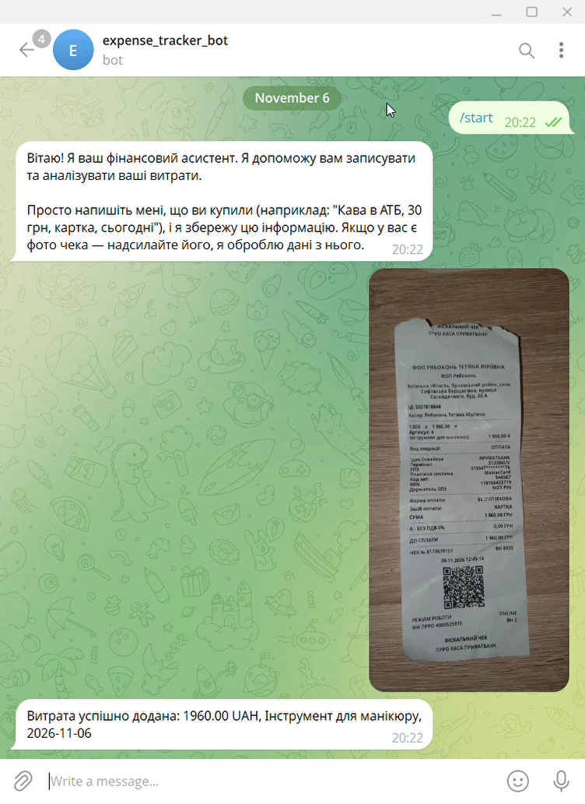

# AI Expense Agent

**n8n · Gemini (vision) · Telegram Bot API · Google Sheets**

A Telegram AI agent that records expenses from a short text message **or a receipt photo** into Google Sheets and answers questions about spending.

## Architecture — [`expense-agent-workflow.json`](./expense-agent-workflow.json)

```
Telegram Trigger
  → Has photo?
      ├─ yes → Telegram: download the largest photo size ─┐
      └─ no ───────────────────────────────────────────────┤
                                                           → AI Agent (Gemini, binary images passed through)
                                                                ├─ Window memory (per chat_id)
                                                                ├─ Tool: create_expense  → Google Sheets append
                                                                └─ Tool: get_all_expense → Google Sheets read
                                                           → Telegram: reply
```

The agent extracts store, description, date, amount, currency and payment method (from text or directly from the receipt image), normalizes them (ISO date, `UAH`, numeric amount), asks a clarifying question if a field is missing and continues the unfinished record after the answer.

## Setup
1. Create a Google Sheet with columns `store_name, description, data, payment_method, total_amount, currency`; put its ID instead of `YOUR_EXPENSES_SHEET_ID`.
2. Create a bot via @BotFather; add Telegram, Gemini and Google Sheets credentials in n8n.
3. Activate the workflow and send the bot `Coffee 85 UAH today, card` or a photo of a receipt.

## Demo



Video: [`demo/telegram-demo.mp4`](demo/telegram-demo.mp4) — a receipt photo is recognized and saved to Google Sheets.
