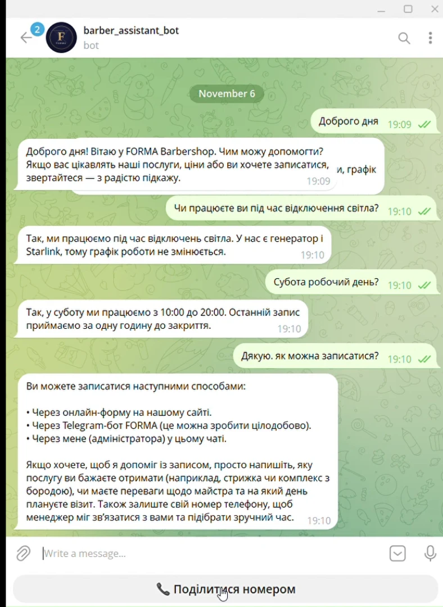
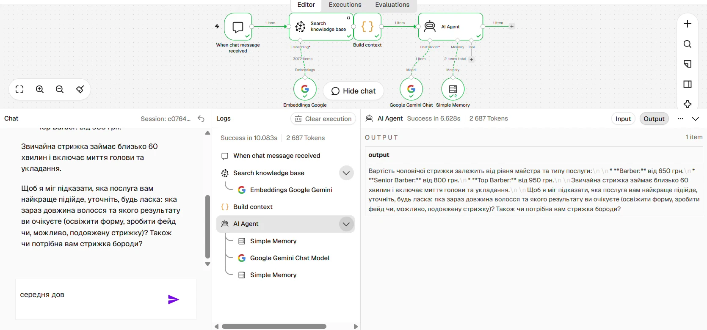

# AI Knowledge Assistant — FORMA Barbershop (RAG)

**n8n · Gemini · Pinecone · Google Drive · Telegram Bot API · Google Sheets**

A virtual administrator for a barbershop. It answers client questions strictly from the company knowledge base — on a website chat and in Telegram — and turns booking intent into a lead with a phone number.

> FORMA is a demo business with a realistic knowledge base (see [`knowledge-base/`](./knowledge-base)): price list by barber level, team & schedule, booking/cancellation policy, FAQ, gift cards & loyalty, retail products.

## Architecture

### 1. Knowledge base ingestion — `ingestion-workflow.json`
```
Google Drive Trigger (new Google Doc in folder, polling every minute)
  → Download file
  → Default Data Loader (text extraction + chunking)
  → Embeddings: Gemini (gemini-embedding-001, 3072 dims)
  → Pinecone (insert, namespace: forma_kb)
```

### 2. Web chat — `web-chat-workflow.json`
```
Chat Trigger (public hosted chat)
  → Pinecone search (top-6 chunks)       ← retrieval runs on EVERY message
  → Build context (question + retrieved fragments)
  → AI Agent (Gemini + window memory per session)
```

### 3. Telegram bot — `telegram-bot-workflow.json`
```
Telegram Trigger
  ├─ /start            → welcome message
  ├─ shared contact    → Prepare lead → Google Sheets (leads) → notify manager in Telegram → thank client
  └─ text message      → "typing…" → Pinecone search → Build context → AI Agent
                            → Parse reply
                               ├─ [ASK_PHONE] → reply + native "📞 Share phone number" keyboard
                               ├─ [PHONE: …]  → lead branch (phone typed manually)
                               └─ otherwise   → reply
  AI Agent error → polite fallback message
```

## Design decisions
- **Deterministic retrieval instead of a vector-store tool.** With a lightweight model the agent sometimes skipped the tool and invented prices. Retrieval now always runs first, and the system prompt forbids numbers that are not in the retrieved fragments.
- **Lead capture without an external CRM.** The agent emits a service tag `[ASK_PHONE: <what the client wants>]`; a Code node strips it, stores the request in workflow static data and shows Telegram's `request_contact` button. The shared contact is merged with the stored request into a Google Sheets row.
- **Resilience.** Retries on the chat model, a fallback reply on agent errors, HTML parse mode so usernames with `_` don't break messages.

## Setup
1. Create a Pinecone index **without a schema** (dimension 3072, cosine) — n8n's Pinecone node doesn't support schema-based indexes.
2. Import the workflows and create credentials: Google Drive, Google Sheets, Gemini API, Pinecone, Telegram (one bot token per workflow).
3. Replace placeholders: `YOUR_DRIVE_FOLDER_ID`, `YOUR_PINECONE_INDEX`, `YOUR_LEADS_SHEET_ID`, `YOUR_MANAGER_CHAT_ID`.
4. Leads sheet columns: `Дата, Ім'я, Username, Телефон, Запит, Chat ID, Статус`.
5. Activate ingestion, add documents to the folder, then activate the chat and Telegram workflows.

## Demo

| Telegram bot | Web chat (n8n logs) |
|---|---|
|  |  |

- Videos: [`demo/telegram-demo.mp4`](demo/telegram-demo.mp4), [`demo/webchat-demo.mp4`](demo/webchat-demo.mp4)
- Workflows on canvas: [`telegram-bot-workflow.png`](demo/telegram-bot-workflow.png), [`web-chat-workflow.png`](demo/web-chat-workflow.png)
