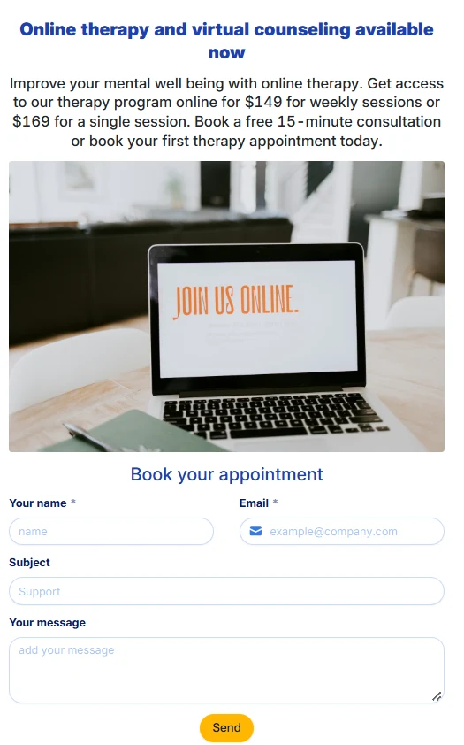
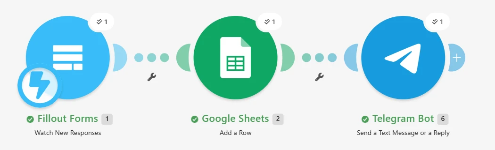
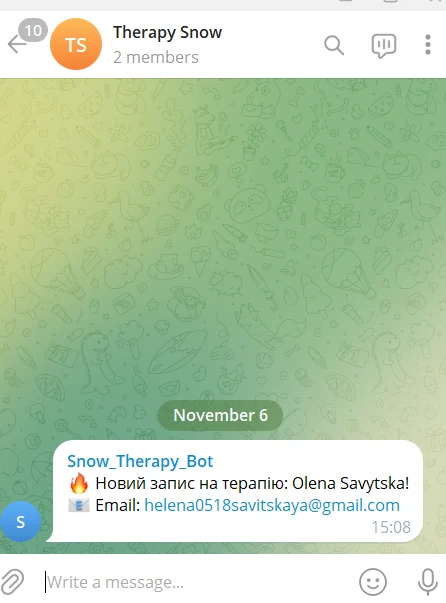
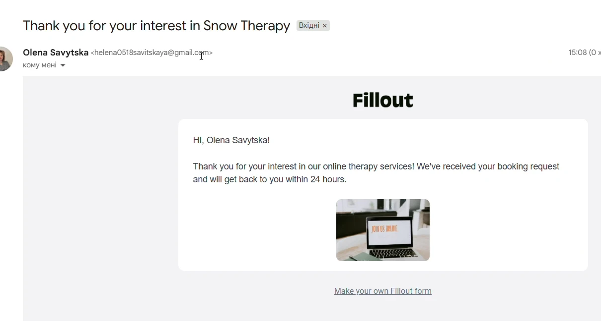

# Booking Automation (Snow Therapy)

**Fillout · Make · Google Sheets · Gmail · Telegram Bot API · Webhooks**

End-to-end lead processing for an online therapy service.

## Flow

```
Fillout landing form (submit)
  → Make: Fillout "Watch New Responses" (webhook)
  → Google Sheets: Add a Row (Date, Time, Name, Email, Subject, Message, Status)
  → Telegram Bot: notification to the admin group
+ Fillout: automatic confirmation email to the client
```

## Screenshots

| Form | Make scenario |
|---|---|
|  |  |

| Telegram notification | Confirmation email |
|---|---|
|  |  |

<!-- Export the Make blueprint (Scenario → ⋯ → Export Blueprint) and add it here as blueprint.json -->
